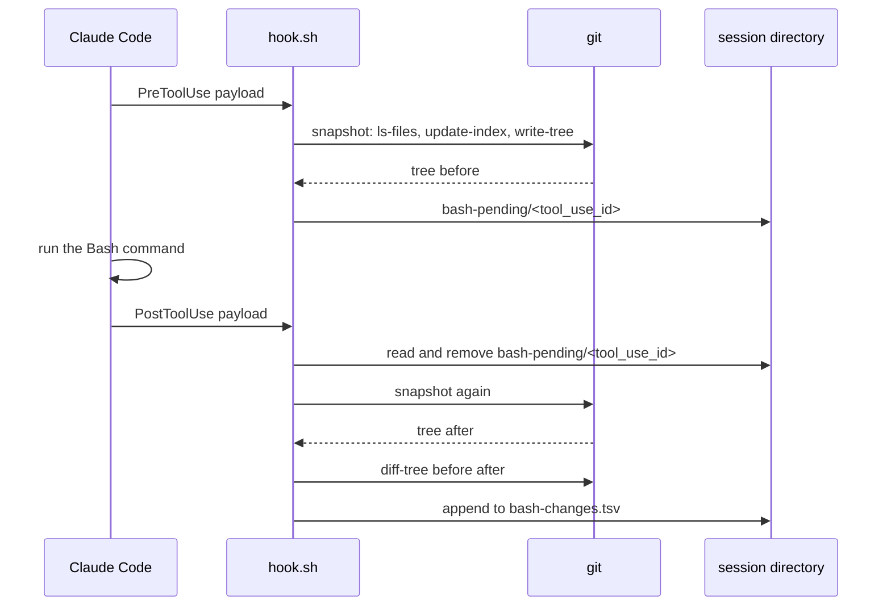

# Walkthrough

This file follows one Bash call through [`hook.sh`](../hook.sh), step by step, with the real output of each command. [README.md](../README.md) describes what the hook does for a user. This file is for a person who reads or changes the code.

The output below comes from a run in a scratch repo on 2026-10-11, with git 2.55.0 and jq 1.7. The paths are shortened to `/tmp/demo`. Tree and blob IDs depend only on file content, so they are the same in each run.

## Example

The repo has two committed files, `tracked.txt` (`a`) and `old.txt` (`b`). Before the call, `tracked.txt` already has an uncommitted change: a second line `x`. The session working directory is the subdirectory `src/`.

Claude runs this Bash call:

```bash
cd .. && echo y >> tracked.txt && echo n > new.txt && rm old.txt
```

The call modifies a file that was already modified, creates one file, and deletes one file.

## Overview



## Step 1: Claude Code starts the hook

`settings.json` registers the hook three times, all with the `Bash` matcher: `PreToolUse`, `PostToolUse`, and `PostToolUseFailure`. Claude Code runs it with `bash`, sends a JSON payload on stdin, and waits at most 10 seconds. Other hooks on the same event run at the same time, so this hook does not wait for them.

The `PreToolUse` payload of the example:

```json
{
  "session_id": "S1",
  "transcript_path": "/tmp/demo/projects/-repo/S1.jsonl",
  "cwd": "/tmp/demo/repo/src",
  "permission_mode": "default",
  "hook_event_name": "PreToolUse",
  "tool_name": "Bash",
  "tool_input": {
    "command": "cd .. && echo y >> tracked.txt && echo n > new.txt && rm old.txt",
    "description": "x"
  },
  "tool_use_id": "toolu_01ABC"
}
```

The `PostToolUse` payload has the same `tool_use_id`, which is how the hook pairs the two events. The hook does not read `tool_input.command`.

## Step 2: Read the payload

Section `# --- Payload ---` in `hook.sh`.

1. The hook exits 0 when `jq` or `git` is not on `$PATH`.
2. One `jq` call reads five fields and adds the current time. It joins them with the ASCII unit separator (`\x1f`, shown as `^_` below):

   ```text
   PreToolUse^_S1^_toolu_01ABC^_/tmp/demo/repo/src^_/tmp/demo/projects/-repo/S1.jsonl^_2026-10-11T19:24:03.215Z
   ```

3. `read` splits that line into `event`, `id`, `tool_use_id`, `cwd`, `transcript`, and `now`.

The hook does not use a tab as the separator. Tab is a whitespace character for `IFS`, so `read` merges two tabs and an empty field moves the next fields one position. `jq` makes the timestamp, and not `date`, because BSD `date` on macOS has no milliseconds. The transcript timestamps have milliseconds, and `session-files` sorts the two sources together by time.

## Step 3: Find the session directory

The hook keeps its state next to the transcript, in `<project dir>/<session id>/`. Claude Code already uses that directory for `subagents/` and `tool-results/`.

```bash
dir=${transcript%%/"$id"[./]*}/$id
```

The pattern removes the longest end of the path that starts with `/S1.` or `/S1/`. It gives the same result for both transcript types:

| `transcript_path`                                     | `dir`                         |
| ----------------------------------------------------- | ----------------------------- |
| `/tmp/demo/projects/-repo/S1.jsonl`                   | `/tmp/demo/projects/-repo/S1` |
| `/tmp/demo/projects/-repo/S1/subagents/agent-a.jsonl` | `/tmp/demo/projects/-repo/S1` |

Thus a Bash call in a subagent goes to the same log as a call in the main session.

## Step 4: Find the repo (PreToolUse only)

Branch `PreToolUse)` of the `case`.

```console
$ git -C /tmp/demo/repo/src rev-parse --show-cdup
../
```

`--show-cdup` gives the relative path from the working directory to the repo root. The hook runs `cd "$cwd/$cdup" && pwd -L` and gets `/tmp/demo/repo`. When `cwd` is not in a git repo, `rev-parse` fails and the hook exits 0.

The hook does not use `git rev-parse --show-toplevel`, because that command resolves symlinks. If the repo is under a symlinked directory, the Edit and Write paths in the transcript keep the symlink. `pwd -L` also keeps it, so the same file gets the same path from both sources.

## Step 5: Point git at the session storage

Function `use_repo`. It runs in the main shell, not in a `$(...)` subshell, so its exports also apply to the `git diff-tree` call in step 10.

1. Get the absolute path of the repo object directory: `git rev-parse --path-format=absolute --git-path objects`. This also works in a linked worktree, where `.git` is a file.
2. Name the session index by the hash of the repo path, so each repo gets its own index:

   ```console
   $ printf '%s' /tmp/demo/repo | git hash-object --stdin
   a7b4f9d0641f0d701bf21c26a8013abcdac9601c
   ```

3. Make `bash-pending/`, `bash-index/`, and `bash-objects/`.
4. Export two variables:
   - `GIT_OBJECT_DIRECTORY=<dir>/bash-objects`: git writes new objects there.
   - `GIT_ALTERNATE_OBJECT_DIRECTORIES=<repo>/.git/objects`: git can still read the objects of the repo.

With these two variables, git can read the repo objects, but it writes no object to the repo.

## Step 6: Take the first snapshot

Function `snapshot`. It prints a tree ID that describes the content of each file in the working tree, without `.gitignore` files.

1. **Copy the index.** `mktemp "$index.XXXXXX"` makes a temporary file next to the session index. The hook copies the session index into it. If no session index exists yet, it copies the repo index. In a repo without commits there is no repo index, so the hook removes the empty temporary file, and git starts a new index.
2. **List the changed files.** `git ls-files -z -m -o -d --exclude-standard` compares the working tree with the index copy. It prints modified files (`-m`), untracked files (`-o`), and deleted files (`-d`). `-z` separates the names with NUL bytes, so a name with a space or a newline stays intact. On the first snapshot of the example, it lists `tracked.txt`, which has the uncommitted `x` line.
3. **Hash the files.** `git update-index -z --add --remove --replace --info-only --stdin` reads that list:
   - `--add` adds new files, and `--remove` removes deleted files.
   - `--replace` allows a file to replace a directory with the same name, or the opposite.
   - `--info-only` computes the blob ID but does not store the file content. This keeps the session storage small.
   - A nested git repo is listed as `dir/`. `update-index` prints `Ignoring path dir/` and continues.
4. **Write the tree.** `git write-tree --missing-ok` writes tree objects from the index to `bash-objects/` and prints the root tree ID. `--missing-ok` is necessary, because the blobs from step 3 are not in an object directory.
5. **Store the index.** `mv -f` renames the temporary file to the session index. A rename is atomic, so a parallel Bash call reads the old index or the new index, never a half-written one.

The tree of the example:

```console
$ git ls-tree 2a0ebc085501185050a9b91dcc9e3d45d5b748e9
100644 blob 61780798228d17af2d34fce4cfbdf35556832472	old.txt
100644 blob 93829c7b4af9dfbeea3b31395b042a614d7a190d	tracked.txt
```

The blob of `tracked.txt` is the uncommitted version (`a`, `x`), not the committed one. So the snapshot describes the disk, not the last commit.

## Step 7: Store the pending snapshot

The hook writes the repo path and the tree ID to `bash-pending/<tool_use_id>`:

```text
/tmp/demo/repo	2a0ebc085501185050a9b91dcc9e3d45d5b748e9
```

Then it exits 0 with no output. Claude Code runs the Bash command.

## Step 8: Read the pending snapshot (PostToolUse)

Branch `PostToolUse | PostToolUseFailure)` of the `case`. A failed command raises `PostToolUseFailure`, but it can still have changed files, so both events take the same branch.

1. If `bash-pending/<tool_use_id>` does not exist, the hook exits 0. This occurs when the first snapshot failed.
2. The hook reads the repo path and the tree ID, and removes the file.
3. It calls `use_repo` with the stored repo path, not with the `cwd` of this payload. The command in the example ran `cd ..`, but the stored path makes sure that the hook compares the same repo.

## Step 9: Take the second snapshot

The same `snapshot` function, but now the session index exists. It holds the stat data (size, mtime, inode) of each file from step 6. `ls-files` compares the stat data and lists only the files that changed since then:

```text
new.txt
old.txt
old.txt
tracked.txt
```

`old.txt` shows two times, because it matches `-m` and `-d`. `update-index` accepts the duplicate.

Git reads and hashes only these files, so a later snapshot does not depend on the size of the untracked files. See [performance.md](performance.md#hook-latency) for the measured times. The hook compares the new tree ID with the old one. If they are equal, nothing changed, and the hook exits 0.

## Step 10: Compare and log

```bash
git -C "$top" diff-tree -r -z --no-renames --name-status "$before" "$after"
```

- `-r` goes into subdirectories, so the output has file paths, not directory names.
- `--no-renames` reports a rename as one `D` and one `A`, so each line has one path.
- `--name-status` gives a status letter and a path, and no content. That is why the missing blobs from `--info-only` are not a problem: `diff-tree` compares only the blob IDs in the two trees.
- `-z` gives NUL-separated output. The `while` loop reads the status and the path with `read -d ''`.

Each change goes to `bash-changes.tsv` with the time from step 2 and the absolute path:

```text
2026-10-11T19:24:03.236Z	A	/tmp/demo/repo/new.txt
2026-10-11T19:24:03.236Z	D	/tmp/demo/repo/old.txt
2026-10-11T19:24:03.236Z	M	/tmp/demo/repo/tracked.txt
```

The `M` line shows the reason for the trees. `git status` showed `tracked.txt` as modified before and after the call, so a status compare would not see the change.

## Step 11: The session directory after the call

```text
/tmp/demo/projects/-repo/S1/bash-changes.tsv
/tmp/demo/projects/-repo/S1/bash-index/a7b4f9d0641f0d701bf21c26a8013abcdac9601c
/tmp/demo/projects/-repo/S1/bash-objects/2a/0ebc085501185050a9b91dcc9e3d45d5b748e9
/tmp/demo/projects/-repo/S1/bash-objects/92/ed41b76664b278ba7e121f4a936fd4d4e0723b
```

`bash-pending/` is empty again. `bash-objects/` holds two objects: the tree before and the tree after. It holds no blob, because of `--info-only`.

## Step 12: The skill reads the log

The [`session-files`](../../../skills/session-files/) script reads `bash-changes.tsv` and the Edit and Write calls from the transcript. It sorts all changes by time and groups them by path. The first change of a path decides `created` or `modified`, and a path that does not exist now is `deleted`. For the example, run from the repo root, it prints:

```text
created    1  bash      new.txt
deleted    1  bash      old.txt
modified   1  bash      tracked.txt
```

## Failure behavior

Each step that can fail ends the hook with exit 0 and no output: missing `jq` or `git`, no git repo, no pending file, or a failed `git` command. A failure never blocks the Bash call. The cost of a failure is a missing log line for that call.
